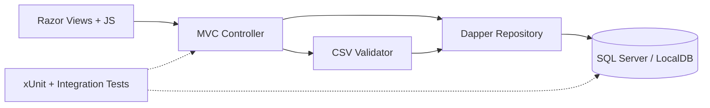

<div align="center">

# 📇 PADO ContactFlow

### Modern contact management, without unnecessary complexity.

**ASP.NET Core MVC · .NET 10 · Dapper · SQL Server · Razor Views**

[](https://github.com/PADOALEX/ContactManager/actions/workflows/ci.yml)


**An interview-ready demonstration of practical .NET engineering:** validated CSV imports, atomic database writes, safe query construction, full contact CRUD, and automated tests against a real SQL Server.

[Getting started](#quick-start--windows-localdb) · [Features](#features) · [Architecture](#architecture) · [Verification](#testing) · [Security](#security-and-production-limitations)

</div>

---

## Features

- Create contacts individually; browse, edit and delete with confirmation.
- Server-side search/filter on the *whole* database, column whitelisting and deterministic sorting.
- Server-side pagination (1–100 rows/page), plus clearly labeled instant filtering/sorting of the visible page.
- Import UTF-8 CSV with/without BOM; strict validation, duplicate detection, row-level errors and **atomic transactions**.
- Antiforgery protection on write operations, Dapper parameterized SQL and structured logging.
- Exact `DECIMAL(18,2)` handling: salary stays decimal text in the browser and is parsed by C# `decimal`, never JavaScript floating point.
- Unit, HTTP smoke and SQL Server integration tests, GitHub Actions CI, optional SQL Server Docker Compose.

### Feature overview

| Contacts | CSV import | Engineering |
| :-- | :-- | :-- |
| Create, edit, delete and confirm destructive actions | Strict UTF-8/BOM decoding and exact headers | Dapper with parameterized SQL |
| Global server search, filters, sorting and pagination | Per-row diagnostics and duplicate detection | Transactions with all-or-nothing semantics |
| Responsive Razor/Bootstrap table and quick page tools | 5 MB and 10,000-row input limits | Antiforgery, xUnit, SQL Server CI |

> **Scope:** This is a deliberately compact server-rendered MVC application, not a public contact-book SaaS. Its lack of sign-in is intentional for a local interview demo.

## Prerequisites

- .NET 10 SDK
- Windows **SQL Server LocalDB** (recommended for simple Windows setup), full SQL Server, or Docker with Microsoft SQL Server 2022
- SQL Server Management Studio or `sqlcmd` to apply database setup scripts

## Quick start — Windows LocalDB

1. Install .NET 10 SDK and SQL Server Express LocalDB (for example via Visual Studio Installer).
2. Create/start LocalDB and initialize the database (in order):

```powershell
sqllocaldb info
sqllocaldb start MSSQLLocalDB
sqlcmd -S '(localdb)\MSSQLLocalDB' -E -b -i Database/001_CreateDatabase.sql
sqlcmd -S '(localdb)\MSSQLLocalDB' -E -b -i Database/002_CreateContactsTable.sql
sqlcmd -S '(localdb)\MSSQLLocalDB' -E -b -i Database/003_UniquePhone.sql
```

`sqlcmd` is a separate install on some Windows systems. You can instead run the three scripts in order in SSMS, including `GO` batch delimiters. `Database/003_UniquePhone.sql` stops with a helpful error if an old database already contains duplicate phone values; clean those records before re-running.

3. Restore/build/run from the repository root:

```powershell
dotnet restore PADO.ContactFlow.sln
dotnet build PADO.ContactFlow.sln -c Release --no-restore
dotnet run --project src/PADO.ContactFlow.Web/PADO.ContactFlow.Web.csproj
```

The default appsettings points to `ContactManagerDb` on `(localdb)\MSSQLLocalDB`. Find the actual local URL in the `dotnet run` output.

## Optional Docker SQL Server (Windows/Linux)

For users who prefer SQL Server 2022 in Docker:

```powershell
Copy-Item .env.example .env
# Edit .env: set a unique strong MSSQL_SA_PASSWORD (do not commit .env).
docker compose up -d
```

Apply SQL files 001–003 using SSMS or `sqlcmd` against `localhost,1433`; then configure the application with **user secrets** or environment variables (never commit a real password):

```powershell
cd src/PADO.ContactFlow.Web
dotnet user-secrets init
dotnet user-secrets set "ConnectionStrings:DefaultConnection" "Server=localhost,1433;Database=ContactManagerDb;User Id=sa;Password=YOUR_LOCAL_PASSWORD;Encrypt=True;TrustServerCertificate=True;"
cd ../..
dotnet run --project src/PADO.ContactFlow.Web
```

`TrustServerCertificate=True` is **local-development only**. Use a real trusted TLS certificate for production. Docker SQL Server uses more RAM than LocalDB; LocalDB is fine for a lightweight interview demo.

## CSV contract

Required column names (order arbitrary):

```csv
Name,Date of birth,Married,Phone,Salary
Ada Lovelace,1815-12-10,false,+441234567890,1200.50
```

- File size: **5 MB max**, **10,000 data rows max**.
- Encoding: **UTF-8**, optionally with UTF-8 BOM. Strict decoding rejects invalid bytes.
- Name: required, <=200 chars. Phone: required, <=50 chars and unique per database.
- Date: `yyyy-MM-dd` or `dd.MM.yyyy`, not later than today.
- Married: `true/false`, `yes/no`, or `1/0` (case insensitive).
- Salary: nonnegative `DECIMAL(18,2)`, dot decimal separator or a **quoted** Ukrainian comma decimal, and <=2 fractional digits.
- Duplicate phone in file or database: rejected. **All-or-nothing**: if one row fails, zero are inserted. Unexpected SQL errors also roll back the whole transaction.
- CSV uses quoted fields for names containing commas. Errors list CSV line numbers. Each import reports the number of rows checked and the number committed.

Try `Samples/contacts-valid.csv` and `Samples/contacts-invalid.csv`. When testing repeated imports, use fresh phone values because uniqueness is enforced.

## Testing

```powershell
dotnet test PADO.ContactFlow.sln -c Release --filter 'Category!=SqlServer'
```

To execute real SQL integration tests, configure an administrative connection **to a test server** (`CONTACTFLOW_TEST_CONNECTION`); see [testing instructions](docs/TESTING.md). The integration suite creates a randomly named isolated database, verifies CRUD and rollback, then drops it. GitHub Actions provides a disposable SQL Server container for the integration job.

> **Verified on GitHub Actions (October 18, 2026):** .NET 10 Release build (**0 warnings, 0 errors**), **29/29 unit and MVC tests**, JavaScript syntax check, and **1/1 SQL Server integration test** succeeded on the latest code. [See the successful main-branch CI](https://github.com/PADOALEX/ContactManager/actions/runs/39124553339) and [test report](docs/TESTING.md). Manual Windows/LocalDB browser testing is not claimed to be completed.

## Architecture

This is intentionally **one web project + one test project**, not a microservice or Clean Architecture showcase. The controller handles HTTP concerns, the CSV service validates import content, the repository handles Dapper SQL/transactions, Razor provides SSR rendering, and vanilla JavaScript handles inline editing. More detail: [architecture decisions](docs/architecture.md).



**The key trade-off:** A single MVC project keeps the code easy to navigate while SQL constraints and transactional imports protect correctness at the database boundary.

## Security and production limitations

- All state-changing endpoints use antiforgery tokens. SQL search is parameterized and sorting uses an enum allowlist.
- Database unique index and transaction prevent duplicate/partial writes even under a concurrent import race.
- No built-in authentication/authorization: use for **local portfolio demonstration**, not exposure as a public multi-user product without adding auth and rate limiting.
- Configuration examples contain no real credentials; `.env`, local appsettings overrides and user secrets must stay outside version control.

## Tech stack

.NET 10 · ASP.NET Core MVC · Razor · Dapper · Microsoft.Data.SqlClient · SQL Server/LocalDB · CsvHelper · Bootstrap · JavaScript · xUnit · GitHub Actions

## Project status

The canonical branch is **`main`**; GitHub Actions builds the application and tests it with a real SQL Server container. Updates to this small portfolio project are welcome through pull requests, with automated dependency-update PRs via Dependabot.

- **Current scope:** Local demonstration application, intentionally without user accounts.
- **Before real deployment:** Add identity and authorization, per-user data isolation, HTTPS with trusted certificates, application monitoring and deployment-specific hardening.
- **Verification:** [CI workflow](.github/workflows/ci.yml) · [Testing report](docs/TESTING.md) · [Security notes](SECURITY.md)

---

<div align="center"><sub>Built as a practical C# / ASP.NET Core MVC portfolio project · PADO</sub></div>
